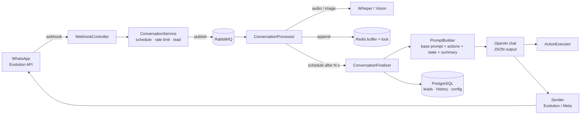

# WhatsApp AI Agent

> AI receptionist for clinics on WhatsApp: it buffers bursts of messages, keeps conversation memory, understands audio and images, and triggers business actions through structured LLM output.

🇧🇷 *Agente de IA para atendimento de clínicas via WhatsApp: agrupa mensagens, mantém memória da conversa, entende áudio e imagem e executa ações de negócio.*


---

## Why it's interesting

People on WhatsApp don't send one message — they send five in a row, a voice note and a photo. A naive bot answers each one separately. This agent treats a conversation as a stream:

- **Debounced turns** — messages are appended to a per-conversation buffer in Redis (atomic Lua script). A lock + delayed task waits a few seconds of silence, then answers the whole burst once.
- **Async pipeline** — the webhook only validates and enqueues; processing happens off a RabbitMQ queue, so slow LLM calls never block WhatsApp.
- **Multimodal input** — voice notes are transcribed (Whisper) and images described (vision model) before entering the conversation. Message types are handled by pluggable processors (`MessageProcessorRegistry`).
- **Conversation memory** — besides the chat history in PostgreSQL, the agent keeps a structured *state* (stage + collected fields) and a rolling *summary*, both updated by the model on every turn.
- **Structured actions** — the model must return JSON with `response`, `updatedState`, `updatedSummary` and `actions`. Actions (send a contact, redirect, call an external system) are configured per company and executed by the backend, not improvised by the LLM.
- **Guardrails** — per-contact rate limiting with temporary blocking, business-hours schedule, AI on/off per number, and human hand-off when an attendant replies from the phone.

## Architecture



### One turn, step by step

1. Evolution API posts the message to `/webhook/message-evolution`.
2. `ConversationService` resolves the company number, checks schedule / AI enabled / spam, gets or creates the **lead** and publishes to RabbitMQ.
3. `ConversationProcessor` converts the message to text (transcribing or describing media), appends it to the Redis buffer and, if no lock exists, schedules finalization.
4. After `FINALIZE_SECONDS` of quiet, `ConversationFinalizer` drains the buffer, loads state + summary, builds the system prompt and calls the model.
5. The JSON reply updates memory, runs the requested actions and the text is sent back to the user.

## Project structure

```
whatsappai/src/main/java/ggctech/whatsappai
├── controller/webhook     # inbound webhooks (Evolution, Meta)
├── event                  # RabbitMQ producer / consumer
├── service/conversation   # buffer, lock, scheduler, finalizer, prompt builder
│   ├── message            # per-type processors (text, audio, image)
│   └── sender             # outbound providers (Evolution, Meta)
├── service/ai/openapi     # chat, transcription, image analysis
├── service/action         # executes actions returned by the model
├── domain                 # leads, history, memory, company config
└── config                 # Rabbit, Redis, OpenAI, security, scheduler
```

## Running locally

Requirements: Docker, Java 21, an OpenAI API key and an [Evolution API](https://github.com/EvolutionAPI/evolution-api) instance connected to a WhatsApp number.

```bash
cd whatsappai
cp .env.example .env          # fill in OPENAI_API_KEY and EVOLUTION_API_BASE_URL
docker compose up -d          # PostgreSQL, Redis, RabbitMQ
./mvnw spring-boot:run
```

Point the Evolution API webhook to `http://<host>:8080/webhook/message-evolution`. The `dev` profile creates the schema automatically (`ddl-auto: update`); register a `CompanyNumber` with its `instanceId` and base prompt to start answering.

| Variable | Default | Purpose |
|---|---|---|
| `OPENAI_API_KEY` | — | Chat, transcription and vision |
| `EVOLUTION_API_BASE_URL` | `http://localhost:8081` | WhatsApp gateway |
| `FINALIZE_SECONDS` | `30` | Silence window before answering a burst |
| `LOCK_SECONDS` | `20` | Conversation lock TTL |

## Roadmap

- [ ] Meta Cloud API inbound parser (outbound sender already exists)
- [ ] Flyway migrations instead of `ddl-auto`
- [ ] Integration tests with Testcontainers
- [ ] Admin endpoints to manage companies, prompts and actions
- [ ] Prompt/response evaluation set to catch regressions

## License

MIT
